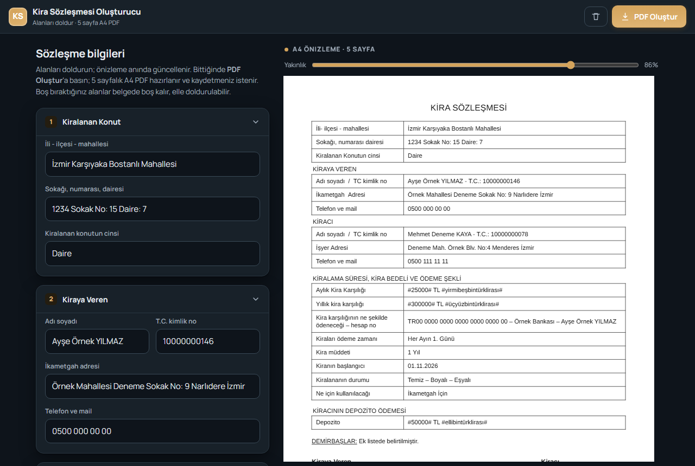
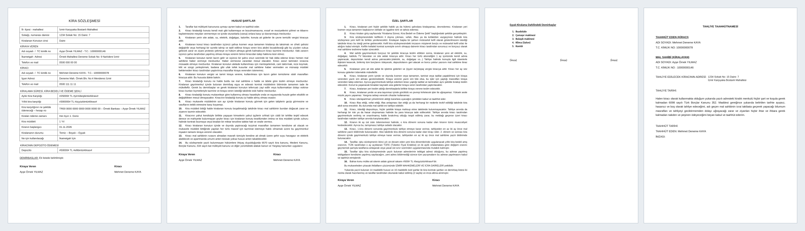

# Kira Sözleşmesi Oluşturucu

Telefon, tablet veya bilgisayarda formu doldurup **5 sayfalık, baskıya hazır A4 PDF kira sözleşmesi** üreten, tek dosyalık bir web uygulaması. Kurulum, sunucu veya hesap gerektirmez; girilen bilgiler cihazdan dışarı çıkmaz.



## İçindekiler

- [Özellikler](#özellikler)
- [Hızlı başlangıç](#hızlı-başlangıç)
- [Kullanım](#kullanım)
- [Form alanları](#form-alanları)
- [Oluşturulan belge](#oluşturulan-belge)
- [Otomatik davranışlar](#otomatik-davranışlar)
- [Veriler ve gizlilik](#veriler-ve-gizlilik)
- [PDF nasıl üretiliyor](#pdf-nasıl-üretiliyor)
- [Sorun giderme](#sorun-giderme)
- [Proje yapısı](#proje-yapısı)
- [Geliştirme](#geliştirme)
- [GitHub Desktop ile yayınlama](#github-desktop-ile-yayınlama)
- [Hukuki not](#hukuki-not)
- [Lisanslar](#lisanslar)

## Özellikler

- **Tek dosya:** Uygulamanın tamamı `kira-sozlesmesi.html` içindedir; çift tıklayıp tarayıcıda açmak yeterlidir.
- **Canlı A4 önizleme:** Yazdıkça 5 sayfalık belge anında güncellenir. Önizleme ekrana otomatik sığar; *Yakınlık* kaydırıcısıyla büyütülüp küçültülebilir.
- **Tek tuşla PDF:** *PDF Oluştur* düğmesi 5 sayfalık A4 PDF'i cihaz üzerinde üretir ve indirir. Yazdırma penceresi gerekmez.
- **Tutarlar yazıyla:** Rakamı girmeniz yeterli; belgeye `#25000# TL #yirmibeşbintürklirası#` biçiminde yazılır.
- **Her bilgi bir kez girilir:** İsimler imza alanlarına, kiracı ve mal sahibi bilgileri tahliye taahhütnamesine otomatik geçer.
- **Otomatik kayıt:** Girilen bilgiler cihazda saklanır; sayfa kapanıp açılınca geri gelir.
- **Mobil uyumlu:** Telefon, dikey ve yatay tablet ile bilgisayar ekranlarına uyum sağlar; açık ve koyu tema desteklenir.
- **İnternetsiz çalışır:** Belge yazı tipleri dosyanın içine gömülüdür; PDF üretimi için internet gerekmez.
- **Kendi kendini teşhis eder:** Dosya JavaScript çalıştırmayan bir uygulamada açılırsa ya da kod hata verirse sayfanın üstünde kırmızı bir açıklama çıkar.

## Hızlı başlangıç

### Bilgisayarda

`kira-sozlesmesi.html` dosyasına çift tıklayın; varsayılan tarayıcıda (Chrome, Edge, Firefox) açılır.

### Android tablet / telefonda

> **Önemli:** Dosyayı mutlaka **Chrome** ile açın. Dosya yöneticisinden dokunulduğunda Android dosyayı çoğu zaman yerleşik *HTML Görüntüleyici*de açar. Bu görüntüleyici JavaScript çalıştırmaz: sayfa görünür ama alanlar önizlemeye geçmez ve düğmeler çalışmaz.

1. Dosyayı cihaza indirin.
2. Chrome → menü (⋮) → **İndirilenler** → dosyaya dokunun.
   *Alternatif:* Dosya yöneticisinde dosyaya basılı tutun → **Birlikte aç** → **Chrome**.

Dosya yanlış uygulamada açılırsa sayfanın en üstünde kırmızı bir uyarı bunu söyler.

### Bağlantıdan kullanmak (GitHub Pages, isteğe bağlı)

Depo GitHub'da yayınlandıktan sonra **Settings → Pages → Branch: `main` / `(root)` → Save** adımlarıyla uygulamayı bir web adresinden açabilirsiniz:

```
https://<kullanıcı-adınız>.github.io/<depo-adı>/kira-sozlesmesi.html
```

Bu adres tablette Chrome'da açılabilir ve **Ana ekrana ekle** ile uygulama gibi kullanılabilir. Böylece dosya indirme sorunları ortadan kalkar. Not: Ücretsiz GitHub hesaplarında Pages yalnızca **herkese açık (public)** depolarda çalışır. Uygulama kodunda kişisel veri yoktur; girilen bilgiler yine yalnızca cihazda kalır.

## Kullanım

1. Formdaki gruplarda alanları doldurun. Boş bırakılan alanlar belgede boş kalır, elle doldurulabilir.
2. Sağdaki (dar ekranda alttaki) önizlemeden kontrol edin.
3. **PDF Oluştur**'a basın. Düğmede sayfa ilerlemesi görünür (`Hazırlanıyor… 3/5`). Bittiğinde PDF indirilir.
   Dosya adı kiracının adını içerir: `Kira Sözleşmesi - Ad SOYAD.pdf`.
4. Yeni bir sözleşme için üstteki 🗑 düğmesine basın. Çıkan **"Tüm alanlar silinsin mi? Sil / Vazgeç"** şeridinden onaylayın.

Bilgisayarda `Ctrl + P` ile doğrudan yazdırmak da mümkündür; sayfa düzeni A4'e göre ayarlıdır.

## Form alanları

| Grup | Alanlar | Belgedeki yeri |
|---|---|---|
| 1. Kiralanan Konut | İli-ilçesi-mahallesi, sokağı-numarası-dairesi, konutun cinsi | Sayfa 1; tahliye adresi (sayfa 5) |
| 2. Kiraya Veren | Adı soyadı, T.C. kimlik no, ikametgah adresi, telefon ve mail | Sayfa 1; imza alanları (sayfa 1–3); sayfa 5 |
| 3. Kiracı | Adı soyadı, T.C. kimlik no, işyeri adresi, telefon ve mail | Sayfa 1; imza alanları (sayfa 1–3); sayfa 5; PDF dosya adı |
| 4. Süre, Kira Bedeli ve Ödeme | Aylık kira, yıllık kira, ödeme şekli – hesap no, ödeme zamanı, kira müddeti, başlangıç tarihi, kiralananın durumu, kullanım amacı, depozito | Sayfa 1 |
| 5. Özel Şartlardaki Değerler | Site aidatı var mı (Evet/Hayır), güncel site aidatı, yetkili mahkeme (varsayılan: İZMİR) | Özel şartlar madde 16 ve kapanış (sayfa 3) |
| 6. Demirbaş Listesi | Her satıra bir demirbaş | Sayfa 4 (numaralı liste) |
| 7. Tahliye Taahhütnamesi | Tahliye tarihi, taahhüt tarihi | Sayfa 5 |

**Tutar alanları** (aylık/yıllık kira, depozito, aidat) yalnızca rakam bekler. Nokta kullanılabilir (`25.000`), virgülden sonrası yok sayılır. Alanın altında yazıyla okunuşu anında gösterilir. Desteklenen üst sınır trilyonlardır.

## Oluşturulan belge



| Sayfa | İçerik |
|---|---|
| 1 | **Kira Sözleşmesi** – konut, taraflar, kira bedeli ve ödeme şekli, depozito tabloları, imza alanı |
| 2 | **Hususi Şartlar** – 14 madde, imza alanı |
| 3 | **Özel Şartlar** – 15 veya 16 madde (aidata göre), yetkili mahkeme, kapanış metni, imza alanı |
| 4 | **Eşyalı Kiralama Dahilindeki Demirbaşlar** – numaralı liste, 3 imza alanı |
| 5 | **Tahliye Taahhütnamesi** – kiracı ve mal sahibi bilgileri, tahliye adresi ve tarihi, taahhüt metni |

## Otomatik davranışlar

- **Aidat seçimi:** *Evet* seçiliyse Özel Şartlar madde 16 (site aidatı) eklenir; tutar boşsa `## TL ##` olarak kalır. *Hayır* seçilirse madde 16 çıkarılır ve kapanış metnindeki "16 maddelik özel şartlar" ifadesi "15 maddelik" olur.
- **İmza alanları:** Kiraya veren ve kiracı adları sayfa 1–3'teki imza alanlarına otomatik yazılır.
- **Tahliye taahhütnamesi:** Kiracı ve mal sahibinin adı, T.C. kimlik numarası ve tahliye adresi (sokak + ilçe/mahalle) ilk sayfadaki bilgilerden alınır.
- **Uzun demirbaş listesi:** Liste 4. sayfaya sığmazsa yazı boyutu sığana kadar otomatik küçültülür (60 kalem denenmiştir).
- **Tarihler** `GG.AA.YYYY` biçiminde yazılır.
- **Mahkeme adı** büyük harfe çevrilir (`izmir` → `İZMİR MAHKEMELERİ VE İCRA DAİRELERİ`).

## Veriler ve gizlilik

- Girilen bilgiler hiçbir sunucuya gönderilmez. Tarayıcının yerel deposunda (`localStorage`, anahtar: `kira_sozlesmesi_v2`) yalnızca o cihazda saklanır.
- Kayıt, dosyanın açıldığı **adrese** bağlıdır. Aynı dosya farklı bir konumdan veya yeniden indirilip açılırsa önceki bilgiler görünmeyebilir.
- Ortak kullanılan cihazlarda işiniz bitince 🗑 ile bilgileri silin.
- Depoya hiçbir gerçek sözleşme veya kişisel veri eklenmemelidir. `.gitignore` dosyası PDF, Word ve fotoğraf dosyalarını bu yüzden dışarıda tutar.

## PDF nasıl üretiliyor

1. Her A4 sayfası, sayfanın kendi stil ve gömülü yazı tipleriyle bir SVG (`foreignObject`) görüntüsüne dönüştürülür. Bu yöntem iframe veya dış kütüphane kullanmaz.
2. Görüntü bir `canvas` üzerinde **3 kat** çözünürlükte (≈ **288 dpi**) çizilir ve JPEG'e çevrilir.
3. Uygulamanın içindeki küçük PDF yazıcısı 5 JPEG sayfayı tam A4 (595 × 842 pt) sayfalara yerleştirir.

**Sonuç:** Önizlemeyle birebir aynı, baskıda net bir PDF. Dosya boyutu yaklaşık **3 MB** olur. PDF'teki metin görüntü olduğu için **seçilip kopyalanamaz**.

## Sorun giderme

| Belirti | Olası neden | Çözüm |
|---|---|---|
| Üstte kırmızı **"Bu dosyayı açan uygulama JavaScript çalıştırmıyor"** uyarısı; alanlar önizlemeye geçmiyor, düğmeler çalışmıyor | Dosya Android'in HTML Görüntüleyicisi veya dosya önizlemesiyle açılmış | Dosyayı Chrome ile açın (bkz. [Android](#android-tablet--telefonda)) |
| Üstte kırmızı **"Sayfa kodu çalışırken hata oluştu (sorunları bildirin)"** kutusu | Tarayıcı kodun bir bölümünü çalıştıramadı (ör. çok eski tarayıcı) | Kutudaki metni olduğu gibi bildirin; Chrome'u güncelleyin |
| PDF indirilmedi | Tarayıcının indirme izni veya depolama alanı | Chrome → İndirilenler'e bakın; site için indirme izni verin |
| *PDF oluşturulamadı* mesajı | Bellek yetersizliği veya tarayıcı kısıtlaması | Sayfayı yenileyip tekrar deneyin; diğer sekmeleri kapatın |
| Önizleme çok küçük/büyük | Ekran boyutu değişti | *Yakınlık* kaydırıcısını kullanın |
| Daha önce girilen bilgiler yok | Dosya farklı bir konumdan/tarayıcıdan açıldı | Bkz. [Veriler ve gizlilik](#veriler-ve-gizlilik) |

## Proje yapısı

```
.
├── kira-sozlesmesi.html     Uygulamanın tamamı (HTML + CSS + JavaScript + gömülü yazı tipleri)
├── docs/
│   ├── uygulama.png         README ekran görüntüsü (uydurma verilerle)
│   └── ornek-pdf-sayfalar.png  Örnek 5 sayfa (uydurma verilerle)
├── licenses/
│   ├── README.md            Üçüncü taraf lisans açıklaması
│   ├── Arimo-OFL.txt
│   └── Carlito-OFL.txt
├── .gitignore
├── .gitattributes
└── README.md
```

## Geliştirme

Derleme adımı yoktur; `kira-sozlesmesi.html` dosyasını bir metin editöründe düzenleyip tarayıcıda yenilemeniz yeterlidir. Dosyayı **UTF-8** olarak kaydedin; aksi hâlde Türkçe karakterler bozulur.

| Değiştirmek istediğiniz | Dosyadaki yer |
|---|---|
| Form alanları | `<div class="formCol">` içindeki `<details class="group">` blokları. Her alanın `data-k` anahtarı vardır. |
| Belge sayfaları | `<div id="doc">` içindeki 5 adet `<section class="page">`. Değişken yerler `data-r="..."` ile işaretlidir. |
| Hususi şartlar | `<div class="cl hs">` |
| Özel şartlar | `<div class="cl oz">` (madde 16: `id="madde16"`) |
| Alanların belgeye yazılması | Betikteki `render()` fonksiyonu |
| Rakamın yazıyla okunuşu | `yazi()` ve `para()` fonksiyonları |
| PDF üretimi | `pageToJpeg()`, `buildPdf()`, `makePdf()` |

Hususi şart sayısını değiştirirseniz Özel Şartlar kapanışındaki "14 maddelik hususi" ifadesini de güncelleyin. Özel şart sayısı aidat seçimine göre otomatik yazılır.

Yerel bir sunucuyla denemek için (isteğe bağlı):

```bash
python -m http.server 8000
```

Ardından tarayıcıda `http://localhost:8000/kira-sozlesmesi.html` adresini açın.

**Değişiklikten sonra kontrol listesi:** alanlar önizlemeye geçiyor mu; PDF 5 sayfa çıkıyor mu ve hiçbir sayfa taşmıyor mu; aidat *Evet/Hayır* ile madde 16 ve 15/16 sayısı doğru değişiyor mu; 🗑 onay şeridi çalışıyor mu; telefon genişliğinde (≈375 px) sayfa yana taşıyor mu.


## Hukuki not

Bu uygulama bir belge doldurma aracıdır, **hukuki danışmanlık değildir**. Sözleşme metni örnek bir kira sözleşmesinden alınmıştır. Kullanmadan önce metnin güncel mevzuata (ör. 6098 sayılı Türk Borçlar Kanunu) ve kendi durumunuza uygunluğunu bir hukukçuya kontrol ettirmeniz önerilir.

## Lisanslar

- Belgede kullanılan yazı tipleri (Arimo ve Carlito'dan türetilen BelgeEkYazi) **SIL Open Font License 1.1** ile dağıtılır. Ayrıntılar ve lisans metinleri: [`licenses/`](licenses/README.md).
- Uygulama kodu için henüz bir lisans seçilmemiştir. Seçilene kadar varsayılan telif hakları geçerlidir. GitHub'da **Add file → Create new file → `LICENSE`** ile şablon seçilerek eklenebilir.
